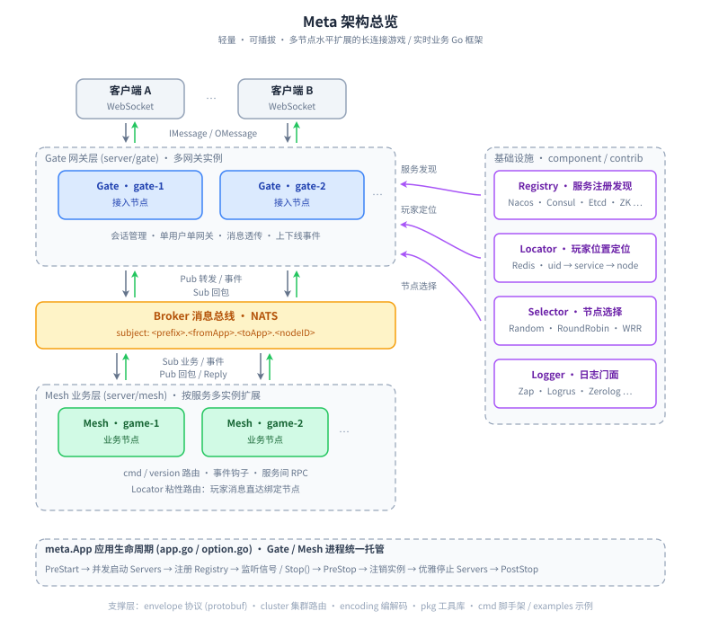

# Meta

<p align="center">
  
</p>

<p align="center">
  <a href="https://go.dev/"></a>
  <a href="https://codecov.io/gh/byteweap/meta"></a>
  <a href="https://goreportcard.com/report/github.com/byteweap/meta"></a>
</p>

Meta 是一个轻量、可插拔、面向长连接游戏/实时业务的 Go 服务框架。它把网关接入、业务逻辑、服务发现、消息通信、玩家位置定位和节点选择拆成清晰的工程边界，让游戏服可以按服务横向扩展，同时保留足够薄的核心运行时。

## 设计目标

- **网关轻量化**：`gate` 只处理 WebSocket 连接、会话管理、消息透传和上下线事件，不承载业务逻辑。
- **业务服务自治**：`mesh` 作为后端逻辑服务运行单元，通过路由注册处理客户端消息、服务间 RPC 和玩家事件。
- **基础设施可替换**：Broker、Registry、Locator、Selector、Logger 都以接口定义在 `component` 下，具体实现放在 `contrib`。
- **面向水平扩展**：通过服务注册发现、节点选择器和玩家位置定位器，把用户流量稳定路由到目标服务节点。
- **保持核心简单**：核心只定义生命周期、通信原语、消息 envelope 和组件边界，限流、分房、匹配、状态同步等策略留给业务层。

## 架构概览



典型部署中，一个应用进程由 `meta.App` 管理生命周期；进程可以挂载一个或多个 `server.Server` 实例。`gate` 负责客户端入口，`mesh` 负责游戏逻辑或其它后端业务能力。服务实例启动后会注册到 `registry.Registry`，网关通过服务发现监听后端节点变化，并使用 `selector.Selector` 选择目标节点。

## 目录结构

```text
.
├── app.go / option.go          # 应用生命周期、全局选项、服务注册与优雅停止
├── server/                     # 服务运行单元抽象和内置服务
│   ├── server.go               # Server 接口，统一 Gate/Mesh 生命周期
│   ├── gate/                   # WebSocket 网关服务
│   └── mesh/                   # 后端逻辑服务和消息路由
├── component/                  # 核心组件接口
│   ├── broker/                 # pub-sub / request-reply 消息代理抽象
│   ├── registry/               # 服务注册发现抽象
│   ├── locator/                # 玩家位置定位抽象
│   ├── selector/               # 节点选择抽象
│   └── log/                    # 日志抽象
├── contrib/                    # 可选组件实现，按独立模块组织
├── encoding/                   # json/proto/msgpack/yaml/toml/xml 编解码器
├── envelope/                   # 由 idl/envelope 生成的 protobuf 消息
├── internal/cluster/           # 集群 subject、header、系统事件定义
├── pkg/                        # 通用工具包
├── examples/                   # gate、game、gate-client 示例
└── cmd/meta/                   # 命令行脚手架入口
```

## 核心生命周期

`meta.New(...).Run()` 是应用入口。`App` 的主要职责是把服务实例、基础设施组件和进程生命周期串起来：

1. 根据 `ID/Name/Version/Metadata/Endpoint` 构建 `registry.ServiceInstance`。
2. 执行 `PreStart` 钩子。
3. 并发启动所有 `server.Server`。
4. 等待全部服务的 `Ready` 信号后，把实例注册到 `Registry`。
5. 执行 `PostStart` 钩子。
6. 运行期间响应 `SIGTERM/SIGQUIT/SIGINT`、父上下文取消或外部 `Stop()`；启动失败也进入同一清理流程。
7. 取消运行上下文，使用独立的清理上下文执行 `PreStop`，注销已成功注册的实例。注册失败由注册器回滚已确认取得的资源并返回错误。
8. 停止所有配置的 server，并等待已启动的 `Start` 返回。
9. 执行全部 `PostStop` 钩子，合并返回启动和清理错误。任一清理步骤失败都继续执行后续步骤。

每个 App 及其服务实例只用于一次运行。`Stop()` 只发出停止请求，可重复调用，也可从钩子中调用；等待 `Run()` 返回才能确认清理结束并取得错误。全部清理步骤共享 `StopTimeout`，默认 10 秒，钩子和自定义服务应遵守传入的上下文截止时间。Endpoint 或启动前钩子失败时，也会停止已配置服务以释放提前分配的资源。

`server.Server` 是框架运行单元的最小协议：

```go
type Server interface {
    Kind() Kind
    Start(ctx context.Context) error
    Ready() <-chan struct{}
    Stop(ctx context.Context) error
    Endpoint(ctx context.Context) (*url.URL, error)
}
```

`Ready` 从构造起返回同一通道，必要初始化和消息订阅生效后关闭；失败时不发送就绪信号。`Start` 持续运行到停止或失败，`Stop` 应允许在启动前或启动期间调用。Gate、Mesh 和业务自定义 server 均遵循这一契约。NATS 的订阅会等待服务端确认后再返回。

## Gate 设计

`server/gate` 是客户端接入层，基于 `github.com/olahol/melody` 封装 WebSocket 服务。

`Gate.Stop(ctx)` 会停止接收新连接和后台任务，关闭现有连接，并等待断开回调、消息循环、订阅及服务监听退出。解绑和下线通知使用独立的清理上下文，每次最多 10 秒；停止后的回调同时受首个 Stop 上下文约束。运行上下文取消不会直接使断开清理失效。

并发、重复 Stop 共享同一次清理结果，各自用传入的 context 限制等待。超时不会把后台清理标记为完成，后续 Stop 仍可继续等待。组件关闭在锁外独立执行；没有 context 的关闭方法无法被强制终止。WebSocket 管理器在所有已准入请求和断开回调结束后才关闭，避免遗漏升级中的连接。

订阅清理等待 `Subscription.Close` 返回，完成语义由组件提供。当前 NATS 适配器的 Close 调用异步 Drain，返回不代表其内部回调已全部结束。

启动时，Gate 会：

- 从 `meta.Context` 中读取应用 ID 和服务名。
- 校验必需组件：`Locator`、`Broker`、`Discovery`、`SelectorFunc`，以及身份验证函数 `UserIDExtractor`。
- 监听 TCP 地址并生成 `ws://host:port` endpoint。
- 注册 Melody 的连接、断开、二进制消息、错误和关闭回调。
- 订阅自己的 broker subject，用来接收 Mesh 回给客户端的消息。

WebSocket 握手前，Gate 调用显式配置的 `UserIDExtractor` 验证请求凭据。返回正数表示认证用户 ID，非正数返回 HTTP 401，未配置则启动失败。验证函数每次握手仅调用一次，结果直接传入会话；客户端传入的 `uid` 不会被网关自动采用。连接建立后，Gate 会：

- 为本次连接生成新的会话 ID，调用 `SessionLocator.Claim` 原子绑定用户当前网关及连接身份。
- 绑定成功后才替换本地会话、关闭同一用户的旧连接；绑定明确失败则关闭新连接，保留旧连接。
- 向玩家已绑定的业务节点广播带 `session_id` 的 `online` 或 `reconnect` 事件。

同一网关按用户串行处理连接切换和断开，不阻塞其他用户。断开时，`Release` 只有在节点与会话 ID 都匹配时才释放位置；实际释放成功才发送 `offline`。定位器保留最后会话 ID 及离线状态，Mesh 在处理状态事件前校验当前身份和状态，跳过迟到或过期事件。

Gate 和 Mesh 均要求 `locator.SessionLocator`。Redis 定位器的数据格式和状态事件直接更新，不提供历史兼容。跨网关以原子 Claim 的顺序确定归属；本步骤不提供跨网关强制踢线或可靠事件投递。事件校验与业务回调不构成跨系统事务；远端写入成功但响应丢失时，也无法保证失败请求未改变位置。

客户端二进制消息会被解析为 `envelope.ClientEnvelope`：

```proto
message ClientEnvelope {
  Header header = 1;
  string service = 2;
  bytes payload = 3;
}
```

业务服务启动并注册可用实例后，Gate 即可转发客户端请求。新增服务无需修改配置或重启 Gate。Gate 根据请求的 `service` 名和注册中心的实例列表判断可用性，具体 `cmd/version` 由 Mesh 处理。即使服务只注册了 RPC 路由，客户端业务帧也会转发到该服务，由 Mesh 对未知命令回复 404。

1. Gate 读取请求的 `header` 和 `service`。首次请求按服务名查询注册中心，空结果直接回复 404。同名服务的并发请求共用一次初始化。
2. 发现可用实例后，Gate 建立监听并再取一次快照，覆盖首次查询与监听建立之间的变化。后续请求直接使用本地快照。实例全部下线或监听失败时，Gate 清除缓存，下次请求重新发现。
3. Gate 通过 `locator.Node(ctx, uid, service)` 查询玩家绑定。已绑定时只发给快照中的原实例，绑定失效则回复 503。未绑定时由选择器选取可用实例。
4. Gate 将客户端的原始 Protobuf 帧发往 `<prefix>.<gateName>.<service>.<nodeID>`，并在 Broker 消息头携带 uid、事件类型、回复地址、来源与目标服务，以及读取请求的连接的 `session_id`。

注册中心查询、监听初始化、定位、选点或发布失败时，Gate 在原 WebSocket 连接上回复 503。Gate 的 404 和 503 均为 `RESPONSE`，来源为 Gate，回填原 `seq/cmd/version`，包括 `seq=0`。组件错误详情记入服务端日志。发布成功后若收不到业务响应，客户端通过请求截止时间结束等待。

发现任务的关闭只执行一次，初始化与关闭都纳入 Gate.Stop 等待。旧监听关闭阻塞不会阻止新请求重建，关闭错误会保留在停止结果中。GetService 与 Watch 没有共同的版本协议，因此快照查询和后续通知之间不提供强一致保证。

Mesh 的 `OkResp` / `ErrResp` 在 Broker 头标记 `delivery=response`，并回填请求的 `session_id`。Gate 按 UID 找到本地连接；携带会话 ID 的响应只写入匹配的连接，重连后的新连接不接收旧响应。按 UID 投递给当前连接的推送标记为 `delivery=push`，不携带 `session_id`。Gate 仍原样写出下行字节，不解码 envelope。

滚动升级时默认允许缺少投递标记或会话 ID 的旧响应，此时仍存在旧回包误投风险。先升级 Gate 和 Mesh，迁移自定义发布者，再启用 `gate.StrictSessionDelivery(true)`：自定义响应必须同时设置 `delivery=response` 和原请求的 `session_id`，自定义推送必须设置 `delivery=push`。已有 Broker 适配器须保留这些头。该校验不撤销旧请求的业务操作，也不提供跨网关踢线。详见[迁移与回退](docs/session-reply-isolation/decision.md)。

下行 `ServerEnvelope` 也必须包含 `header`，其 `service` 是来源服务，`kind` 区分 `RESPONSE` 和 `PUSH`。成功响应与推送均省略 `error`；失败响应携带 `error.code`（非零错误码），可附带 `error.message`。业务消息体的选型规则见 [外层协议定义](idl/envelope/envelope.proto)。

`header.seq` 用于请求与响应关联，响应回填原值；`0` 表示无需关联。框架不要求它递增，也不据此排序或去重。`header.sent_at_unix_ms` 是发送方的 Unix 毫秒时间戳，`0` 表示未提供。响应由生成它的 Gate 或 Mesh 填写发送时间，框架不依赖客户端时钟判断消息顺序。

## Mesh 设计

`server/mesh` 是后端逻辑服务。它不直接处理网络连接，而是订阅 broker subject 接收 Gate 或其它服务发来的消息。

Mesh 启动时会校验 `Broker` 和 `Locator`，然后订阅：

```text
<prefix>.*.<appName>.<appID>
```

收到消息后，Mesh 根据 `broker.Message.Reply` 区分两种模式：

- `Reply == ""`：pub-sub 消息，主要用于 Gate 转发的客户端业务消息和系统事件。
- `Reply != ""`：request-reply 消息，用于服务间 RPC。

Gate/Mesh 在每条 broker 消息的处理入口恢复 panic，记录异常及堆栈后继续处理下一条消息。该边界覆盖当前 goroutine 内的消息处理及 Mesh 系统事件回调；业务自行启动的 goroutine 应设置自己的恢复边界。

### 业务路由

Mesh 校验客户端业务消息包含 `header`，再按 `header.cmd` 和 `header.version` 定位处理器。底层路由键使用 `uint64(cmd)<<32 | uint64(version)`，避免字符串拼接开销。

对有响应的客户端命令，用 `mesh.Handle` 绑定类型化请求和返回值。Gate 提供已认证 UID，Mesh 负责解码、调用和回包。

```go
func EnterGame(ctx context.Context, caller mesh.Caller, req *pb.EnterGameRequest) (*pb.EnterGameResponse, error) {
    return &pb.EnterGameResponse{}, nil
}

// 在初始化 Mesh 时注册
m.Route(1, 1, mesh.Handle(EnterGame))
```

- 空 payload 传入 nil 请求。返回 `nil, nil` 表示成功且无响应体。响应回填原请求的 `seq/cmd/version` 和 Broker 会话身份，包括 `seq=0` 的请求。
- 业务可返回 `&mesh.ClientError{Code: 409, Message: "room full"}`，也可用 `%w` 包装。错误码必须非零，提示须为有效 UTF-8。普通错误、无效业务错误、响应体编码失败和类型化处理器 panic 均返回通用 500。
- 客户端路由不存在时返回 404。框架解码业务 payload 失败时返回 400。错误回包依赖可解析的外层 header 和可用的回复地址。
- handler 收到的标准 context 随 Mesh 停止而取消。客户端取消等待后，已经发出的请求仍可执行。

需要单向处理或自行决定回包时机时，使用 `m.Route(cmd, version, mesh.Wrap(fn))`。其 `*mesh.Context` 提供请求元数据和 `OkResp/ErrResp`，handler 结束后归还对象池，异步使用前须调用 `Copy()`。

旧版 `m.RouteX(cmd, version, fn)` 已移除。若 `fn` 的签名为 `func(*mesh.Context, *T)`，将注册语句替换为 `m.Route(cmd, version, mesh.Wrap(fn))`；若已持有 `mesh.MessageHandler`，直接使用 `m.Route(cmd, version, fn)`。同一个命令和版本重复注册会在注册处 panic。

### 系统事件

Gate 会把用户状态变化广播给玩家已经绑定的业务服务节点。Mesh 内置三个事件钩子：

```go
m.OnlineHandler(func(uid int64) {})
m.OfflineHandler(func(uid int64) {})
m.ReconnectHandler(func(uid int64) {})
```

这些事件使用 broker header 中的 `event` 字段区分，不走业务 `cmd/version` 路由。

### 按 UID 主动推送

Mesh 就绪后，可以向指定 UID 发送业务 Protobuf 消息。下面的 `notice` 是业务消息，命令号为 20，版本为 1。传入 `nil` 可以发送空消息体。

```go
err := m.Push(ctx, uid, 20, 1, notice)
```

Mesh 用 UID 和 Gate 的逻辑服务名查询当前会话。默认服务名为 `gate`，自定义名称可在创建 Mesh 时设置 `mesh.GateService("edge")`，对应 Gate 的 `meta.Name("edge")`。Gate 与 Mesh 需要使用同一会话存储和键前缀。

- 用户没有在线会话时，可用 `errors.Is(err, mesh.ErrUserOffline)` 判断。定位、编码和 Broker 发布错误返回给调用方。
- 定位或编码耗尽调用预算时，Mesh 跳过发布。调用方主动取消会通知定位器和 Broker，已进入的网络 I/O 何时返回取决于适配器。
- 返回 `nil` 表示 Broker 适配器接受了发布。使用 NATS 时，此刻消息可能仍在发送缓冲区。客户端收到的 `PUSH` 帧通过 `Pushes()` 分发，`seq` 为 0，来源为 Mesh 服务名。
- 推送按 UID 投递给目标 Gate 的本地连接。若用户在定位后迁往另一个 Gate，本次推送可能丢失，也可能被仍存在的旧连接收到。下一次推送会重新定位。

### 服务间 RPC

Mesh 还提供 request-reply 能力：

```go
m.RPCRoute("hello", "v1", mesh.WrapRPC(Hello))

func Hello(ctx *mesh.RPCContext, req *HelloReq) ([]byte, string, int) {
    return data, "ok", http.StatusOK
}
```

RPC 路由键为 `cmd.version`。`WrapRPC[T]` 会反序列化请求体并创建 `RPCContext`。handler 通过 `ctx.Context()` 获取标准上下文，传给数据库操作或下一次 `Mesh.Request` 即可沿用剩余时间。直接注册的 `RPCMessageHandler` 从首个参数接收标准上下文。返回值约定为：

- `[]byte`：响应数据。
- `string`：提示信息。
- `int`：状态码，`200` 表示成功。

RPC 业务处理器发生 panic 时，框架返回空数据、`500` 和通用提示 `Internal Server Error`，通过现有结果出口回复一次。回复传输本身发生 panic 时记录异常，不重复发送；后续消息仍继续处理。恢复不会撤销处理器已经完成的外部副作用。

调用方为本次 RPC 设置截止时间。

```go
ctx, cancel := context.WithTimeout(parent, 200*time.Millisecond)
defer cancel()
data, tip, code, err := m.Request(ctx, subject, "hello", "v1", payload)
```

配置 Broker 后即可在 Mesh 启动前调用 `Request`。缺少 Broker 时返回 `errors.ErrBrokerRequired`。调用方取消或超时会结束本地等待并返回 Go 错误。主动取消只影响本地等待。跨节点传递绝对截止时间。Mesh 将有效期限以十进制 Unix 毫秒写入 Broker 请求头 `deadline_unix_ms`，向下取整到毫秒，节点时钟应保持同步。没有期限时省略该头，下游沿用自身的 Mesh 上下文。

传输和排队时间计入期限。出队时已过期的请求跳过业务，执行期间到期则通过 `ctx.Done()` 通知 handler。框架在 handler 返回后统一回复，已过期的结果按 504 处理。若截止时间头格式错误或有多个值，Mesh 回复 400。已处理请求的回包使用独立的发送期限，Mesh 停止或到期后仍会尝试发送一次。

#### 入站 RPC 并发

默认情况下，Mesh 在同一消息循环中依次处理 RPC、客户端业务消息和会话事件。业务需要等待数据库或下游服务时，可以为该 Mesh 配置固定数量的 RPC worker 和等待队列。

```go
m := mesh.New(mesh.Broker(bro), mesh.Locator(loc), mesh.RPCConcurrency(2, 16))
```

此例最多同时执行 2 个 RPC，另有 16 个等待位置。队列满时，订阅回调直接回复 503。队列容量为 0 时，只要还有空闲的 worker 名额就能接收请求，包括 Mesh 刚就绪时。请求排队至过期，出队时回复 504。两种拒绝都跳过业务 handler。

客户端业务消息和会话事件仍在原消息循环内顺序处理。RPC 可以与它们并行，也可以彼此并行。多个 handler 读写同一份玩家或房间状态时，业务须同步访问。停服会取消运行中 RPC 的上下文。队列中已过期的请求仍回复 504，其余有效请求回复 503。从运行上下文取消到 RPC 接收关闭，订阅回调收到的新请求也会尝试回复 503。业务应将上下文传给阻塞操作。如果 handler 仍在运行，`Stop(ctx)` 可以超时，后续调用可继续等待清理。

#### 按服务名发送

当任一实例都能处理请求时，使用 `RequestService`。例如创建房间时，调用方只需知道目标服务名。下面使用 `contrib/selector/roundrobin` 提供的轮询选择器。

```go
m := mesh.New(
    mesh.Broker(bro), mesh.Locator(loc),
    mesh.Discovery(reg),
    mesh.SelectorFunc(func() selector.Selector { return roundrobin.New() }),
)

// Mesh 就绪后，由业务传入本次请求的 ctx
data, tip, code, err := m.RequestService(ctx, "room", "create", "v1", payload)
```

首次调用会按服务名建立监听，同名并发调用共享初始化。等待者可以独立取消。最后一个等待者退出时，尚未完成的查询也会收到取消信号。后续请求从本地快照选取一个实例并发送一次，截止时间覆盖发现、传输和业务执行。没有可用实例时可用 `errors.Is(err, selector.ErrNoAvailableNode)` 判断，传输失败直接返回调用方。

源服务名、目标服务名和选中的实例 ID 各占一个 subject 段。Mesh 启动时会拒绝前缀、服务名和实例 ID 中的 `*` 或 `>`。加入已有房间等有状态操作，由业务确定归属实例并通过 `Request` 发往具体 subject。同步嵌套 RPC 应避免循环等待。默认串行模式下，调用链回到正在等待的实例就会阻塞。开启并发后，同一实例的 worker 也可能全部在等待下游。

## 消息与集群协议

框架把业务消息和集群路由信息分开：

- `envelope.ClientEnvelope` 封装上行请求，`envelope.ServerEnvelope` 封装下行响应或推送。
- `broker.Header`：集群内部元数据，例如 uid、event、reply、fromService、toService。
- `cluster.Subject`：broker subject 约定。

subject 格式：

```text
<prefix>.<fromService>.<toService>.<toNodeID>
```

例如：

```text
meta.gate.game.game-1
```

这种设计让业务 payload 保持稳定，同时允许集群层独立演进路由、事件和 reply 语义。

## 组件抽象

Meta 的核心组件都以接口形式存在：

- `component/broker.Broker`：提供 `Pub/Sub/Request/Reply/Close`，用于服务间消息通信。
- `component/registry.Registry`：提供 `Register/Deregister/GetService/Watch`，用于服务注册发现。
- `component/locator.Locator`：维护 `uid -> service -> nodeID`，用于玩家粘性路由；`SessionLocator` 扩展会话认领、条件释放和最后状态查询，供 Gate/Mesh 处理连接归属和状态事件。
- `component/selector.Selector`：根据服务实例列表选择目标节点，支持过滤器扩展。
- `component/log.Logger`：统一日志门面，允许替换为 zap/logrus/zerolog 等实现。
- `encoding.Codec`：统一编解码器注册和查找，内置 json、proto、msgpack、yaml、toml、xml。

`contrib` 提供官方可选实现：

- Broker：NATS。
- Locator：Redis。
- Registry：Nacos、Consul、Etcd、Eureka、Polaris、ServiceComb、Zookeeper。
- Selector：Random、RoundRobin、Weighted RoundRobin。
- Logger：Zap、Logrus、Zerolog、Aliyun、Tencent、Fluent。

这些实现通常以独立 Go module 组织，业务可以只引入实际需要的基础设施依赖。

## 快速示例

### 启动 Gate

下面使用环境变量 `GATE_DEMO_TOKEN` 配置单个演示账户的访问令牌，客户端通过 `Authorization: Bearer <token>` 提交凭据，验证成功后使用用户 ID 1。令牌必须显式设置，无内置默认值。实际业务应在 `UserIDExtractor` 中验证自己的凭据并返回对应用户 ID，不能直接使用请求中的 `uid`。示例需使用标准库 `crypto/subtle`、`net/http` 和 `os`。

```go
token := os.Getenv("GATE_DEMO_TOKEN")
if token == "" {
    panic("GATE_DEMO_TOKEN is required")
}
expectedAuth := []byte("Bearer " + token)

reg := nacos.New(newNamingClient())
loc := redis.New(goredis.UniversalOptions{
    Addrs: []string{"127.0.0.1:6379"},
}, "meta")
bro, _ := nats.New()

err := meta.New(
    meta.ID("gate-1"),
    meta.Name("gate"),
    meta.Version("v1.0.0"),
    meta.Server(gate.New(
        gate.Addr(":9000"),
        gate.UserIDExtractor(func(r *http.Request) int64 {
            if subtle.ConstantTimeCompare([]byte(r.Header.Get("Authorization")), expectedAuth) != 1 {
                return 0
            }
            return 1
        }),
        gate.Locator(loc),
        gate.Discovery(reg),
        gate.Broker(bro),
        gate.SelectorFunc(func() selector.Selector {
            return wrr.New()
        }),
    )),
    meta.Registry(reg),
).Run()
```

### 启动 Mesh

```go
type GameServer struct {
    *mesh.Mesh
}

srv := &GameServer{
    Mesh: mesh.New(
        mesh.Broker(bro),
        mesh.Locator(loc),
    ),
}

srv.Route(1, 1, mesh.Handle(EnterGame))
srv.Route(2, 1, mesh.Handle(ExitGame))
srv.RPCRoute("hello", "v1", mesh.WrapRPC(Hello))

err := meta.New(
    meta.ID("game-1"),
    meta.Name("game"),
    meta.Version("v1.0.0"),
    meta.Server(srv),
    meta.Registry(reg),
).Run()
```

更多完整代码可以参考：

- `examples/gate`
- `examples/game`
- `examples/gate-client`

Go 客户端 `client/gate` 支持并发请求，按 `seq` 匹配响应，使用调用方的上下文取消等待；`Pushes()` 单独接收推送，消费不及且队列满时丢弃新推送。默认同进程重连继续使用递增序号；仅在所有 Gate 启用严格会话投递且回包方均已迁移后，才可用 `WithConnectionSequence()` 让每条连接从 1 开始。断开后由调用方重新连接并重新同步业务状态，客户端不自动重放请求。

启动 Gate 和 game 示例后，在 `examples/gate-client` 运行 `go run ./cmd -url ws://127.0.0.1:<gate-port>/`，并配置与 Gate 相同的 `GATE_DEMO_TOKEN`。

## 工程扩展建议

新增业务服务时，推荐继承组合 `*mesh.Mesh`，再把领域状态放在自己的 server 结构体中。例如 `examples/game/internal/server.Server` 把 `roomSpace` 和 `playerSpace` 放在 Mesh 外层，业务 handler 通过自定义 server 访问领域对象。

新增基础设施适配时，建议放在 `contrib/<component>/<provider>` 下，并实现 `component` 中对应接口。核心包不依赖任何具体 provider，这样可以避免把业务项目不需要的 SDK 带进主模块。

服务间 RPC 的热点路径可用 `RPCRoute + mesh.WrapRPC` 直接调用业务函数。`RPCRouteX` 支持通过反射适配 RPC 函数签名。

如果 handler 内需要异步处理，请复制 `mesh.Context`：

```go
func EnterGame(ctx *mesh.Context, req *EnterGameReq) {
    copied := ctx.Copy()
    go func() {
        _ = copied.UID()
    }()
}
```

## 开发命令

```bash
make check      # 逐模块构建整个项目，使用只读依赖模式
make test       # 运行所有测试
make tidy       # 整理所有 Go module
make envelope   # 根据 idl/envelope/envelope.proto 重新生成 protobuf
make lint       # 运行 golangci-lint
```

Windows 环境也提供了对应脚本：

```powershell
.\tidy.ps1
.\release.ps1
```

## 当前实现边界

- Gate 文本消息处理仍为预留接口，当前业务链路使用二进制 protobuf envelope。
- Gate 的 request-reply 暂未实现，收到带 reply 的请求会返回 `501 Not Implemented`。
- `mesh.Context.Broadcast` 仍是 TODO。
- Broker 层刻意不内置并发、背压、限流、消息合并等业务策略，这些能力应按具体游戏场景放在 Gate、Mesh 或业务服务中实现。
